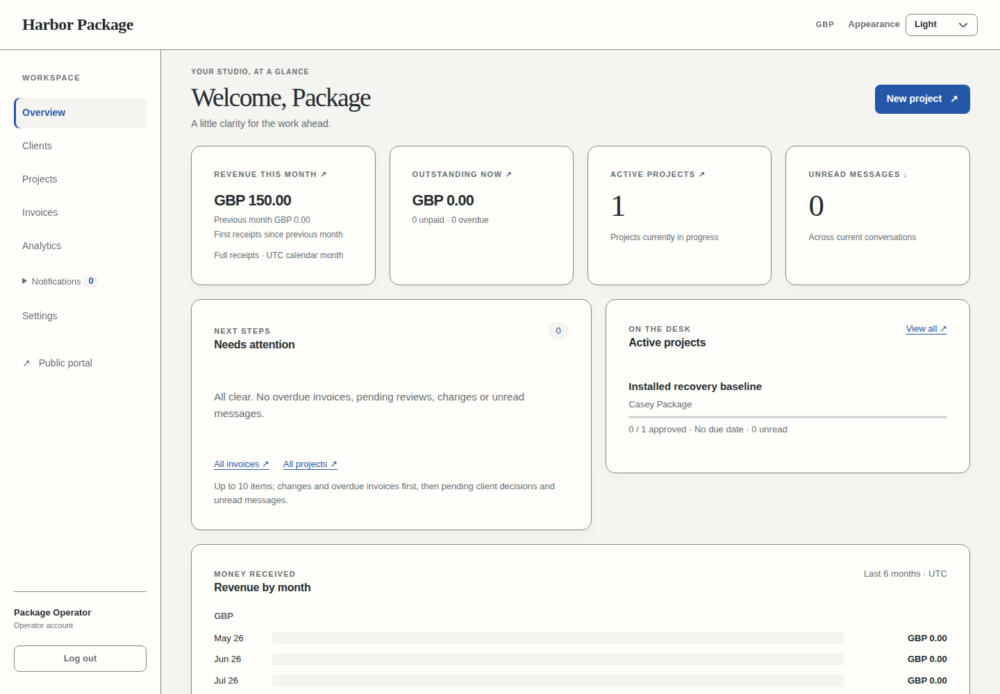

# Yinsen

A self-hosted client portal for freelancers and small agencies: one operator, client accounts and private shared project work. Yinsen is MIT licensed.

Development is ongoing. The current runtime includes operator/client access, projects, milestones, messages, private attachments, negotiated proposals, versioned deliverables, invoices, full manual settlement, direct Stripe Checkout payments, completion/disputes/archive, operator dashboard/analytics and installation settings. Integrated verification and installation/recovery work remain in progress.

## Install and operate

Follow [INSTALL.md](INSTALL.md) for the reproducible, source-bound Docker package,
fresh private installation, optional providers, exact-image qualification and
user-controlled CI/publication. [OPERATIONS.md](OPERATIONS.md) covers consistent
database/file backup, isolated restore, encrypted configuration, opt-in update
and failure recovery. See [CONTRIBUTING.md](CONTRIBUTING.md) and
[SUPPORT.md](SUPPORT.md). Live GitHub/publication/production/website execution
remains unverified.

Actual isolated installation screens with synthetic example data:



[Client deliverables on desktop](screenshots/client-deliverables-desktop.png) ·
[Client deliverables on mobile in dark mode](screenshots/client-deliverables-mobile-dark.png)

## Source Compose development

Use Docker Engine with Compose v2. From the repository root:

```sh
cp .env.example .env
chmod 600 .env
```

Replace the three password placeholders with **three separate** values generated using `openssl rand -hex 32`. Set `APP_ORIGIN` to `http://localhost:3000` for a local installation, or your HTTPS origin. Keep `.env` private.

```sh
docker compose up -d --wait postgres
docker compose build app
docker compose --profile tools build migrate
docker compose run --rm migrate
docker compose run --rm migrate npm run db:status
docker compose up -d --wait app
```

Open `http://localhost:3000` and complete setup: operator account, installation checks and branding. Keep a new installation private until its operator is created. `/api/health` returns HTTP 200 with `data.status: healthy` when the database and schema are ready.

Compose binds the application and database to loopback. Internet-facing installations need an HTTPS reverse proxy and the matching `APP_ORIGIN`. Cookie-protected writes require that exact origin. The application sends HSTS headers; production authentication requires HTTPS, with localhost supported for development.

## Use the portal

The operator signs in at `/login`. Create clients in the dashboard, then generate a single-use login link from their client workspace and share it privately. Clients open the link, confirm sign-in and use their portal. Manual links work without an email provider. Archive/revocation removes access immediately; restoring an account requires fresh access.

Create a project, choose its primary and additional client members, add milestones and send it for lock-in. An eligible member reviews and agrees the scope; the project becomes active. The operator can pause/resume work, and only the current primary client can approve a milestone in review.

When work is ready, the operator requests completion review from the project workspace. The current primary client can accept or request changes with a reason, which appears in the project conversation. Changes return the project to active work for another review. The operator can archive a completed project; its conversation, invoices and authorized file history remain available. A decision must match the current submitted work and review round.

General conversations and project conversations support private messages and attachments. Either party can propose a project in the general conversation, counter its terms or reject it. Accepting the latest proposal creates one active project with the agreed budget and ordered milestones. Manually created projects keep their separate lock-in workflow.

Upload deliverables from a milestone in the project workspace, choosing a new file or a version of an existing deliverable. Every version starts locked. The operator can release or relock each version independently; clients can download only currently released versions, including in the version history. Deliverables use the same private local or S3 storage and per-file size limit as attachments, with one file per upload. Ordinary message attachments remain available without a release or payment gate.

Create invoices from the dashboard. Choose the recipient, currency, line items and optional agreed total override, then review and send. Sending freezes the recipient, financial terms and milestone links. Financial changes require cancellation and a new invoice. Configure numbering and payment instructions in the invoice list. Prefix/counter changes affect future invoices, and used numbers stay reserved. Sending captures the current payment instructions.

With email configured, sending submits the invoice link to the recipient. An email failure leaves the draft available to retry. Without email, send the invoice and privately share its portal link; the recipient must sign in. Record a full manual settlement with its payment method and reference after receiving the exact invoice amount. Partial or excess amounts cannot settle it. Paid and settled invoices cannot be cancelled or deleted.

Link milestones only when payment of **any one linked invoice** should release every deliverable version then present on those milestones. Other linked invoices may remain unpaid. No links means no automatic release. Later uploads remain locked; a repeated settlement does not undo a manual relock.

The operator overview links to overdue invoices, requested changes, pending decisions, unread conversations and active projects. Analytics offers 30-day, 90-day, 12-month and all-time views. Revenue counts each fully paid or settled invoice once in its frozen currency; currencies stay separate. Outstanding balances show current unpaid invoices regardless of the selected period. Project completion uses recorded client acceptance and includes later archive; project/client counts use creation dates. Workspace changes refresh the views automatically, including after reconnect.

Open **Settings** to save branding, public business/contact details, welcome copy, default currency and invoicing defaults in separate sections. Choose a brand colour visually or paste its hex value. Light and dark themes each have custom background and card-surface colours, with presets as starting points. Text and controls adapt for readability; unsupported colour pairs show a validation message and retain your edits. Typography, density, corners and colours have a preview. These are installation choices; the header's light/dark/system preference belongs to the current browser. Reload an already-open page to see saved branding changes. Default-currency changes do not convert existing projects or invoices, and issued invoice identity, contact details, appearance and logo remain frozen.

Settings also manages operator and client sessions. Changing the operator profile requires the current password. Changing the password or signing out all operator sessions invalidates every operator session, including the current one; sign in again afterward. Client session revocation uses the same access controls as the client workspace.

**Allow automatic updates** defaults off and stores permission only. Saving it does not install, restart or deploy anything. Deployment must be configured separately.

Run one long-lived application process. Live updates, rate limits, expired-access cleanup and overdue invoice checks use that process; multiple replicas are not currently supported. Overdue checks run at startup and hourly.

## Configuration and storage

Start from [`.env.example`](.env.example). Provider credentials stay in server environment variables; the browser setup does not collect them. Restart the application after environment changes.

Local storage is the default and requires no external account. Compose persists PostgreSQL in `postgres_data` and uploads in `uploads_data`. Source running uses `./data/uploads` by default, outside build output. Preserve and back up both database and files. Stopping or replacing an application container preserves the named volumes; removing volumes removes their data. Changing initial database passwords in `.env` does not rotate passwords in an existing database.

For private S3-compatible storage, set `STORAGE_DRIVER=s3` and supply `STORAGE_S3_BUCKET`, `STORAGE_S3_REGION`, `STORAGE_S3_ACCESS_KEY` and `STORAGE_S3_SECRET_KEY`. Cloudflare R2 uses region `auto` and `STORAGE_S3_ENDPOINT=https://<account-id>.r2.cloudflarestorage.com`. AWS's standard endpoint is selected by omitting the endpoint and supplying its region. R2 has actual upload/download proof; other vendors have not been independently exercised here. Keep the bucket private. Credentials need Put/Get/Delete object access and HeadBucket for setup verification. S3 mode also requires writable local staging storage.

Attachments stream through currently authorized application endpoints. They have no public file URL or payment gate. `MAX_UPLOAD_SIZE_MB` accepts 1–100 MB per file, with at most five files per message. Failed submissions preserve drafts for retry. Keep original storage available when moving providers: changing configuration does not move existing files.

Brand logos accept PNG, JPEG or WebP up to 2 MiB, or the configured upload cap if lower. Logos use the selected local/S3 storage with a separate public branding URL; private attachments and deliverables keep their own authorization. Replacing or removing the current logo retains old logo bytes for issued invoices and delivered emails. Treat logo contents as public.

Email is optional. Supply both `RESEND_API_KEY` and `EMAIL_FROM_ADDRESS`, or omit both. Use a verified sender domain and disable click tracking for authentication links. The setup verification button submits a test email to Resend's fixed test address and uses provider quota; provider acceptance and actual inbox delivery are distinct. Manual client links remain available if email is unavailable.

## Direct Stripe payments

Clients choose **Pay invoice** on their sent or overdue invoice and pay on Stripe's hosted Checkout page. Checkout collects the frozen invoice total and currency, including an agreed total override. Yinsen records payment and releases linked files only after a verified paid server callback; returning from Checkout grants nothing. This integration accepts cards. Online amount/currency limits apply; manual payment instructions remain available when Checkout cannot collect an invoice.

Set both `STRIPE_SECRET_KEY` and `STRIPE_WEBHOOK_SECRET`, or omit both. A publishable key is not used. Setup verifies access to the Stripe account; actual payment and webhook delivery require a separate end-to-end check. Restart the application after changing these environment values.

For sandbox verification, authenticate Stripe CLI to the same sandbox as the application's test secret. Run the listener on the application host:

```sh
stripe listen --latest --events-from @self \
  --forward-to http://localhost:3000/api/webhooks/stripe \
  --events checkout.session.completed,checkout.session.expired,checkout.session.async_payment_succeeded,checkout.session.async_payment_failed
```

Save that listener's signing secret as `STRIPE_WEBHOOK_SECRET` in the private `.env` and restart the application. Keep the listener running during testing. Use a real sandbox Checkout payment and confirm the invoice, Stripe payment record and client download; fabricated events and browser returns do not establish payment. The app remains on loopback during this local workflow.

For a live installation, use the live account secret and register `https://<your-origin>/api/webhooks/stripe` in Stripe with the same four event types. Use that endpoint's own signing secret. The implementation pins Stripe SDK 23.0.0 and API `2026-09-30.endive`; keep the webhook event version aligned. The local command's `--latest` currently matches this version. Create real invoices in Yinsen after live configuration; sandbox objects do not become live transactions. Live payments enter your Stripe balance and pay out to your linked bank account according to your [Stripe payout settings](https://docs.stripe.com/payouts).

Repeated Pay requests recover the existing attempt. If its outcome remains unknown, resolve it before arranging another payment. After 23 hours an unknown creation is blocked from automatic recreation because Stripe's idempotency retention is finite. The operator can find the session using its `attempt_id` metadata in Stripe and choose **Recover matching session**; this verifies the saved invoice correlation.

Cancellation and manual settlement try to expire open sessions; an unconfirmed expiration remains visible to the operator. A distinct payment arriving after payment, settlement or cancellation appears as a payment exception, including for a soft-deleted invoice in the invoice list. Consult its provider reference in Stripe and use **Record external resolution** to save the outcome. Yinsen does not automatically refund, revive the invoice, count revenue twice or repeat file release.

## Source development

Use Node.js 22.21.1 and npm 10.9.4. Dependencies are pinned in `package-lock.json`; the application uses Next.js, React, TypeScript, PostgreSQL and Drizzle.

```sh
npm ci
docker compose up -d --wait postgres
npm run db:migrate
npm run db:status
npm run dev
```

Source commands load the root `.env`. The example database URLs select separate runtime and migration roles. Use explicit migrations; startup refuses a pending or incompatible schema. To run the built source:

```sh
npm run build
npm start
```

Stop development/built source processes sharing `.next` before another build. Run heavy builds/checks serially.

## Engineering checks

`npm run check` runs strict types, lint, formatting, tests, unfinished-marker checks and a production build. Database tests require a deliberately isolated, fully migrated `yinsen_test_*` database, matching runtime/migrator URLs and `TEST_ISOLATED_DATABASE=1`. Load that private fixture environment first; never use installation/customer data for tests.

```sh
TEST_ISOLATED_DATABASE=1 npm run check
```

Installed HTTP suites are `test:http`, `test:access`, `test:clients`, `test:projects`, `test:messages`, `test:proposals`, `test:deliverables`, `test:invoices`, `test:analytics` and `test:settings`. They require an ordinary running isolated application and its matching `TEST_ORIGIN`. Start a fresh fixture process for each security suite's rate-limit window. `test:setup-race` requires a separate empty, migrated fixture and preserves the setup it creates. The analytics suite needs a configured operator and current client. Run the settings suite against a fresh isolated installation; it creates its own operator and client.

Passing checks supports actual functional verification through the browser, database and configured provider. Component placement, visual hierarchy, responsive layouts, keyboard/focus, failure/retry and private data access also require review in the running application.
